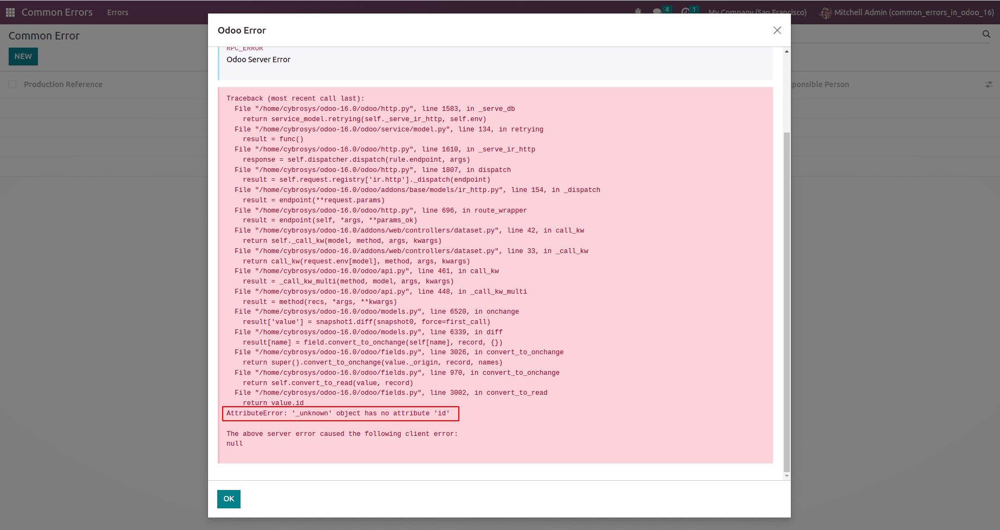
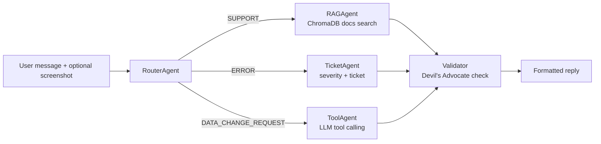

# ERP Helpdesk Agentic AI

A multi-agent AI assistant that automates first-line ERP helpdesk work. Users describe a problem in plain language, optionally with a screenshot, and the system works out what kind of request it is, then answers how-to questions from documentation, turns error reports into tickets, or drafts data-change requests, with a validation step that adds a "Devil's Advocate" check to every reply.

   

<!-- Replace with a real screenshot or GIF of the Gradio UI -->



## What it does

| You send… | The system… |
|---|---|
| "How do I approve a purchase order?" | Retrieves the relevant ERP docs and answers with sources |
| A screenshot of an error dialog | Reads the image (vision + OCR), assigns a severity from 1–5, and creates a ticket |
| "Give Maria access to the Inventory module" | Picks the right action, fills in the details, and drafts a change request |

## How it works



**RouterAgent** classifies each message as `SUPPORT`, `ERROR`, or `DATA_CHANGE_REQUEST`, using the screenshot as extra context, and asks a clarifying question when it isn't sure.

**RAGAgent** searches a ChromaDB vector store built from the ERP guides in `rag_data/` (purchase orders, stock, invoices, vendors, user access, and more) and answers with the source documents listed.

**TicketAgent** analyses the error text and screenshot, assigns a severity from 1 to 5, and produces a structured ticket.

**ToolAgent** uses LangChain tool calling to map a request onto one of four actions: add a user, grant module permission, add a cost code, or add a warehouse. In this demo the actions produce draft requests rather than writing to a live ERP.

**Validator** formats the final reply and attaches category-specific concerns for the user to double-check, such as "verify the steps match your ERP version."

## Tech stack

Python 3.12, LangChain, OpenAI `gpt-4o-mini` (text and vision), ChromaDB, Gradio, Tesseract OCR, and `uv` for dependency management.

## Getting started

### Prerequisites

- Python 3.12
- [uv](https://docs.astral.sh/uv/)
- An OpenAI API key
- *(Optional)* [Tesseract](https://github.com/tesseract-ocr/tesseract) for OCR on screenshots. The app still runs without it, but OCR is skipped.

### Install and run

```bash
git clone https://github.com/mulangph/erp-agentic-ai.git
cd erp-agentic-ai

uv sync

cp .env.example .env
# open .env and add your OPENAI_API_KEY

uv run main.py
```

Then open http://localhost:7860.

On first run the vector store is built automatically from the files in `rag_data/`.

### Configuration

| Variable | Required | Default | Purpose |
|---|---|---|---|
| `OPENAI_API_KEY` | Yes | — | OpenAI access for all agents |
| `ERP_API_BASE_URL` | No | `http://localhost:8000/api` | ERP REST API endpoint |
| `ERP_API_KEY` | No | — | ERP API token |
| `CHROMA_PERSIST_DIR` | No | `./vector_store` | Where the vector store is saved |
| `LOG_LEVEL` | No | `INFO` | Logging verbosity |

No ERP system is needed to try the demo. When the ERP API can't be reached, the client falls back to built-in mock inventory, vendor, and sales data.

## Try these prompts

- `How do I create a purchase order?`
- `What should I check if stock levels look wrong after a transfer?`
- Upload `test_data/image/Odoo_error.png` with the message `I got this when saving an invoice`
- `Please add a new user jsmith with email jsmith@example.com`
- `Create a warehouse called North Yard under the Dubai branch`

## Project structure

```
erp-agentic-ai/
├── main.py                    # Gradio UI and orchestration
├── rag_data/                  # ERP documentation used for retrieval
├── test_data/image/           # Sample error screenshot
└── src/erp_helpdesk/
    ├── config.py              # Settings loaded from .env
    ├── agents/
    │   ├── base_agent.py
    │   ├── router_agent.py
    │   ├── rag_agent.py
    │   ├── ticket_agent.py
    │   ├── tool_agent.py
    │   └── validator.py
    ├── tools/erp_api_client.py   # ERP API client with mock fallback
    └── utils/image_processor.py  # Resizing, encoding, OCR
```

## Limitations

This is a portfolio demo, not a production system. Sessions and ticket IDs are held in memory and reset on restart. Data-change actions create drafts only. There is no authentication, and the automated test suite is still to come.

## Roadmap

- [ ] Automated tests and an evaluation set for routing accuracy
- [ ] Token cost tracking and per-request budget limits
- [ ] Duplicate-ticket detection
- [ ] Tool calling over MCP (see [AI_MCP_Server](https://github.com/mulangph/AI_MCP_Server))
- [ ] pgvector or Pinecone for larger document sets
- [ ] Persistent ticket storage

## License

MIT
